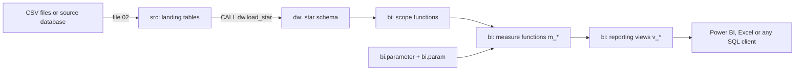
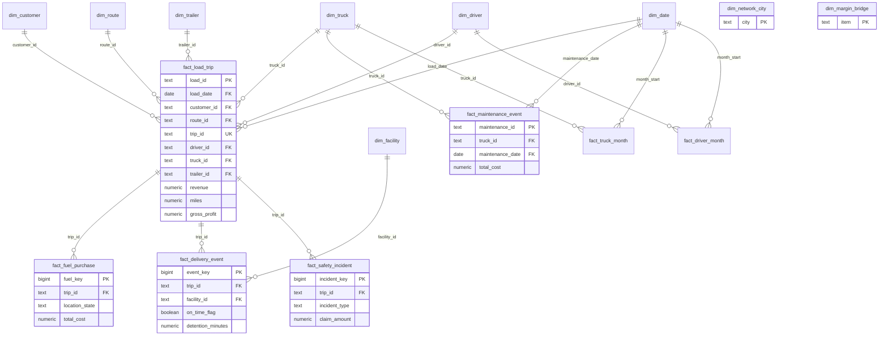

# Schema and relationships

How the database is organised, why, and what every table and column means. For the measures see `MEASURE_CATALOGUE.md`; for running and analysing see `SQL_ANALYSIS_GUIDE.md`.

## 1. Architecture

| Schema | Role | Contents |
|---|---|---|
| `src` | Landing | 14 tables, one per source file or source-system table (the original tables). Loaded as-is |
| `dw` | Star schema | 9 dimensions, 1 helper table, 7 fact tables, `dw.load_star()` and `dw.data_as_of()` |
| `bi` | Analytics | What-if parameters, scoring and colour functions, scope functions, 31 measure functions, 44 reporting views, data-quality views and checks |

## 2. Why a galaxy (fact constellation) schema

The report has several business processes that share the same dimensions: loads and trips, fuel purchases, delivery events, safety incidents, maintenance, and two monthly summaries. A single star cannot hold them because their grains differ, so the warehouse is a **galaxy schema**: seven fact tables that share conformed dimensions (date, customer, route, driver, truck, trailer, facility).

Design decisions, each matching behaviour of the Power BI model:

1. **Loads and trips are one fact.** In the report they are a one-to-one pair joined in both directions, so a driver or truck filter reaches load revenue. `dw.fact_load_trip` has one row per load, with the trip's columns (nullable) folded in.
2. **Child facts carry the conformed keys of their load.** Fuel, delivery and safety rows copy `load_date`, `customer_id`, `route_id`, `driver_id`, `truck_id` and a few attributes from their trip's load. Every dimension therefore filters every fact directly, with no snowflake joins, and date filters follow the load date exactly as in the report.
3. **Maintenance links to trucks only.** `dw.fact_maintenance_event` has no customer or route key. That is why Gross Profit allocates maintenance to loads by miles (decision 4).
4. **Maintenance is allocated by miles.** `dw.month_maint_ratio` holds each month's maintenance cost per mile. `fact_load_trip.maint_alloc = miles x that ratio`, and `gross_profit = revenue - fuel_cost - maint_alloc`. Totals equal actual maintenance for any whole month or year, and customer or route slices carry only their share.
5. **Natural keys are kept.** The source ids are the keys. Add surrogate keys if you later need slowly changing dimensions.
6. **NULL keys are kept, not dropped.** Fuel, delivery and safety rows with no `trip_id` have NULL conformed keys. They count when no filter is set and drop out of date-filtered results, as in the report.
7. **Helper tables stay unrelated.** `dim_network_city` and `dim_margin_bridge` have no relationships, exactly like the Network City and Margin Bridge tables.
8. **Foreign keys are optional.** Primary keys are enforced. Foreign keys live in `03b_optional_foreign_keys.sql` (NOT VALID) because real source data contains orphans; `bi.v_orphan_check` reports them.

## 3. Entity-relationship diagram

Only key columns are shown. Child facts also carry the conformed keys listed in section 5.

`dim_network_city` and `dim_margin_bridge` are intentionally unrelated.

## 4. Relationship table

| # | From (many side) | To (one side) | Note |
|---|---|---|---|
| 1 | `fact_load_trip.load_date` | `dim_date.full_date` | Main date key |
| 2 | `fact_load_trip.customer_id` | `dim_customer.customer_id` |  |
| 3 | `fact_load_trip.route_id` | `dim_route.route_id` |  |
| 4 | `fact_load_trip.driver_id` | `dim_driver.driver_id` |  |
| 5 | `fact_load_trip.truck_id` | `dim_truck.truck_id` |  |
| 6 | `fact_load_trip.trailer_id` | `dim_trailer.trailer_id` |  |
| 7 | `fact_fuel_purchase.trip_id` | `fact_load_trip.trip_id` | Child fact; also carries the conformed keys |
| 8 | `fact_delivery_event.trip_id` | `fact_load_trip.trip_id` | Child fact; also carries the conformed keys |
| 9 | `fact_delivery_event.facility_id` | `dim_facility.facility_id` |  |
| 10 | `fact_safety_incident.trip_id` | `fact_load_trip.trip_id` | Child fact; also carries the conformed keys |
| 11 | `fact_maintenance_event.truck_id` | `dim_truck.truck_id` | Truck only: customer and route filters never reach it |
| 12 | `fact_maintenance_event.maintenance_date` | `dim_date.full_date` |  |
| 13 | `fact_truck_month.truck_id` | `dim_truck.truck_id` |  |
| 14 | `fact_truck_month.month_start` | `dim_date.full_date` |  |
| 15 | `fact_driver_month.driver_id` | `dim_driver.driver_id` |  |
| 16 | `fact_driver_month.month_start` | `dim_date.full_date` |  |

### Mapping to the Power BI model

| Power BI relationship | In SQL |
|---|---|
| Customers to Loads, Routes to Loads, Date to Loads | `fact_load_trip.customer_id`, `route_id`, `load_date` |
| Loads one-to-one Trips (both directions) | One table, `fact_load_trip` |
| Drivers, Trucks, Trailers to Trips | `fact_load_trip.driver_id`, `truck_id`, `trailer_id` |
| Trips to Fuel Purchases, Delivery Events, Safety Incidents | `trip_id`, plus the conformed keys copied from the load |
| Facilities to Delivery Events | `fact_delivery_event.facility_id` |
| Trucks to Maintenance Record and to Truck Utilization Metrics | `fact_maintenance_event.truck_id`, `fact_truck_month.truck_id` |
| Drivers to Driver Monthly Metrics | `fact_driver_month.driver_id` |
| Date to Maintenance Record, Driver Monthly Metrics, Truck Utilization Metrics | `maintenance_date`, `month_start` on each fact |
| Inactive links (fuel and safety to drivers and trucks) | Not modelled; the trip's driver and truck are used |
| Network City, Margin Bridge, parameter tables | `dim_network_city`, `dim_margin_bridge`, `bi.parameter` |

## 5. Grain and conformed keys

| Table | Kind | Grain |
|---|---|---|
| `dw.dim_date` | dim | One row per calendar day, covering every full year in loads |
| `dw.dim_customer` | dim | One row per customer |
| `dw.dim_route` | dim | One row per route |
| `dw.dim_driver` | dim | One row per driver (includes the placeholder DRV_UNKNOWN) |
| `dw.dim_truck` | dim | One row per truck |
| `dw.dim_trailer` | dim | One row per trailer |
| `dw.dim_facility` | dim | One row per delivery facility |
| `dw.dim_network_city` | dim | One row per city that appears as an origin or a destination |
| `dw.dim_margin_bridge` | dim | Fixed rows for the margin waterfall |
| `dw.month_maint_ratio` | helper | One row per calendar month |
| `dw.fact_load_trip` | fact | One row per load; the trip, when there is one, is folded into the same row |
| `dw.fact_fuel_purchase` | fact | One row per fuel purchase |
| `dw.fact_delivery_event` | fact | One row per pickup or delivery event |
| `dw.fact_safety_incident` | fact | One row per safety incident |
| `dw.fact_maintenance_event` | fact | One row per maintenance event; links to dim_truck only |
| `dw.fact_truck_month` | fact | One row per truck per month |
| `dw.fact_driver_month` | fact | One row per driver per month |

Conformed keys copied onto `fact_fuel_purchase`, `fact_delivery_event` and `fact_safety_incident`: `load_id`, `load_date`, `customer_id`, `route_id`, `origin_city`, `destination_city`, `booking_type`, `driver_id`, `truck_id`.

## 6. Source (landing) tables

| Table | Rows | Notes |
|---|---|---|
| `src.customers` | 8 columns | Customer master (200 rows in the reference data). account_status held a single value (Active). |
| `src.drivers` | 7 columns | Driver master. Includes the placeholder driver DRV_UNKNOWN (about 2% of revenue). |
| `src.trucks` | 6 columns | Truck master. Some model_year values are blank. |
| `src.trailers` | 2 columns | Trailer master. |
| `src.facilities` | 6 columns | Delivery facilities with coordinates. |
| `src.routes` | 5 columns | Origin to destination routes with typical distance and base rate per mile. |
| `src.loads` | 8 columns | One row per load (booking). revenue is the load revenue. |
| `src.trips` | 9 columns | One row per trip; one-to-one with loads. |
| `src.fuel_purchases` | 9 columns | Fuel purchases linked to trips. Some rows have no state. |
| `src.maintenance_record` | 10 columns | Maintenance events per truck (links to trucks only). |
| `src.delivery_events` | 8 columns | Pickup and delivery events with detention and on-time flag. |
| `src.safety_incidents` | 12 columns | Safety incidents linked to trips. |
| `src.driver_monthly_metrics` | 5 columns | Pre-computed monthly metrics per driver. |
| `src.truck_utilization_metrics` | 9 columns | Pre-computed monthly metrics per truck. |

Column names and types are in `sql/01_schemas_and_source_tables.sql`. Columns the report uses directly were confirmed; the rest follow the standard logistics schema, so check them against your files first.

## 7. Data dictionary (dw schema)

### dw.dim_date

One row per calendar day, covering every full year in loads.

| Column | Type | Description |
|---|---|---|
| `full_date` (PK) | date | Calendar date (primary key) |
| `year` | integer | Calendar year |
| `quarter` | text | Q1 to Q4 |
| `month_number` | integer | 1 to 12 |
| `month_name` | text | January to December |
| `month_year` | text | yyyymm text, as shown on the report axes |
| `year_month_sort` | integer | yyyymm number, sort key for month_year |
| `year_month` | text | yyyy-mm text |
| `day_name` | text | Mon to Sun |
| `day_number` | integer | Monday = 1 |
| `month_start` | date | First day of the month |

### dw.dim_customer

One row per customer.

| Column | Type | Description |
|---|---|---|
| `customer_id` (PK) | text | Customer identifier (primary key) |
| `customer_name` | text | Customer name |
| `customer_type` | text | Contract, Spot or Dedicated |
| `credit_terms_days` | integer | Payment terms: 15, 30, 45 or 60 days |
| `primary_freight_type` | text | Main freight type |
| `account_status` | text | Account status (a single value in the reference data) |
| `contract_start_date` | date | Contract start |
| `annual_revenue_potential` | numeric | Annual revenue potential, used for wallet share |

### dw.dim_route

One row per route.

| Column | Type | Description |
|---|---|---|
| `route_id` (PK) | text | Route identifier (primary key) |
| `origin_city` | text | Origin city |
| `destination_city` | text | Destination city |
| `route_name` | text | origin → destination |
| `typical_distance_miles` | numeric | Typical route distance |
| `base_rate_per_mile` | numeric | Base rate card, $ per mile |

### dw.dim_driver

One row per driver (includes the placeholder DRV_UNKNOWN).

| Column | Type | Description |
|---|---|---|
| `driver_id` (PK) | text | Driver identifier (primary key) |
| `first_name` | text | First name |
| `last_name` | text | Last name |
| `driver_name` | text | First and last name; the id when the name is missing |
| `hire_date` | date | Hire date |
| `termination_date` | date | Termination date; NULL while employed |
| `employment_status` | text | Employment status (Active) |
| `home_terminal` | text | Home terminal |
| `tenure_years` | numeric | Years from hire to termination, or to the last load date |
| `tenure_band` | text | 0-1 yr, 1-3 yrs, 3-6 yrs, 6+ yrs or Unknown |
| `tenure_band_sort` | integer | Sort key for tenure_band |

### dw.dim_truck

One row per truck.

| Column | Type | Description |
|---|---|---|
| `truck_id` (PK) | text | Truck identifier (primary key) |
| `make` | text | Manufacturer |
| `model_year` | integer | Model year; NULL when unknown |
| `status` | text | Truck status (Active) |
| `home_terminal` | text | Home terminal |
| `fuel_type` | text | Fuel type |
| `truck_age` | integer | Years from model year to the last load date; NULL when model_year is NULL |
| `truck_age_band` | text | 0-2 yrs, 3-5 yrs, 6+ yrs or Unknown |

### dw.dim_trailer

One row per trailer.

| Column | Type | Description |
|---|---|---|
| `trailer_id` (PK) | text | Trailer identifier (primary key) |
| `trailer_type` | text | Trailer type |

### dw.dim_facility

One row per delivery facility.

| Column | Type | Description |
|---|---|---|
| `facility_id` (PK) | text | Facility identifier (primary key) |
| `facility_name` | text | Facility name |
| `city` | text | City |
| `state` | text | State |
| `latitude` | numeric | Latitude |
| `longitude` | numeric | Longitude |

### dw.dim_network_city

One row per city that appears as an origin or a destination.

| Column | Type | Description |
|---|---|---|
| `city` (PK) | text | City (primary key); unrelated to the facts by design |

### dw.dim_margin_bridge

Fixed rows for the margin waterfall.

| Column | Type | Description |
|---|---|---|
| `item` (PK) | text | Revenue, Fuel, Maintenance or Gross Profit (primary key) |
| `sort_order` | integer | Waterfall order |

### dw.month_maint_ratio

One row per calendar month.

| Column | Type | Description |
|---|---|---|
| `month_start` (PK) | date | First day of the month (primary key) |
| `maintenance_cost` | numeric | Maintenance cost dated in the month |
| `miles` | numeric | Trip miles of loads dated in the month |
| `maint_cost_per_mile` | numeric | maintenance_cost divided by miles |

### dw.fact_load_trip

One row per load; the trip, when there is one, is folded into the same row.

| Column | Type | Description |
|---|---|---|
| `load_id` (PK) | text | Load identifier (primary key) |
| `load_date` | date | Load date (dim_date) |
| `customer_id` | text | Customer (dim_customer) |
| `route_id` | text | Route (dim_route) |
| `origin_city` | text | Route origin (denormalized) |
| `destination_city` | text | Route destination (denormalized) |
| `booking_type` | text | Booking type |
| `load_type` | text | Load type |
| `load_status` | text | Delivered, Cancelled and so on |
| `revenue` | numeric | Load revenue (Total Revenue) |
| `expected_linehaul_revenue` | numeric | typical distance x base rate per mile |
| `trip_id` | text | Trip identifier; NULL for a load with no trip (unique when present) |
| `driver_id` | text | Driver (dim_driver) |
| `truck_id` | text | Truck (dim_truck) |
| `trailer_id` | text | Trailer (dim_trailer) |
| `miles` | numeric | Actual trip miles |
| `expected_miles` | numeric | Typical route miles; only for loads with a trip |
| `duration_hours` | numeric | Trip duration in hours |
| `fuel_gallons_used` | numeric | Gallons used on the trip |
| `idle_hours` | numeric | Idle hours on the trip |
| `fuel_cost` | numeric | Fuel purchase cost attributed to the trip |
| `fuel_gallons_purchased` | numeric | Gallons purchased for the trip |
| `maint_alloc` | numeric | Maintenance allocated by miles at the load month's cost per mile |
| `gross_profit` | numeric | revenue less fuel_cost less maint_alloc |

### dw.fact_fuel_purchase

One row per fuel purchase.

| Column | Type | Description |
|---|---|---|
| `fuel_key` (PK) | bigint | Surrogate key (primary key) |
| `fuel_purchase_id` | text | Source identifier |
| `trip_id` | text | Trip (fact_load_trip); NULL when unattributed |
| `purchase_date` | date | Purchase date |
| `location_state` | text | State of purchase; may be blank |
| `gallons` | numeric | Gallons |
| `price_per_gallon` | numeric | Price per gallon |
| `total_cost` | numeric | Total cost |
| `load_id` | text | Load the row belongs to (through its trip); NULL when the row has no trip |
| `load_date` | date | Load date: the date key behind every Date filter in the report |
| `customer_id` | text | Customer of the load (dim_customer) |
| `route_id` | text | Route of the load (dim_route) |
| `origin_city` | text | Route origin city (denormalized for lane analysis) |
| `destination_city` | text | Route destination city (denormalized for lane analysis) |
| `booking_type` | text | Booking type of the load |
| `driver_id` | text | Driver on the trip (dim_driver) |
| `truck_id` | text | Truck on the trip (dim_truck) |

### dw.fact_delivery_event

One row per pickup or delivery event.

| Column | Type | Description |
|---|---|---|
| `event_key` (PK) | bigint | Surrogate key (primary key) |
| `event_id` | text | Source identifier |
| `trip_id` | text | Trip (fact_load_trip) |
| `facility_id` | text | Facility (dim_facility) |
| `event_type` | text | Event type (Delivery) |
| `scheduled_datetime` | timestamp | Scheduled time |
| `actual_datetime` | timestamp | Actual time |
| `detention_minutes` | numeric | Minutes of detention |
| `on_time_flag` | boolean | On-time flag |
| `is_delivery` | boolean | event_type = Delivery |
| `detention_hours` | numeric | detention_minutes / 60 |
| `detention_bucket` | text | None, 0-1 h, 1-2 h, 2-4 h or 4 h+ |
| `detention_bucket_sort` | integer | Sort key |
| `load_id` | text | Load the row belongs to (through its trip); NULL when the row has no trip |
| `load_date` | date | Load date: the date key behind every Date filter in the report |
| `customer_id` | text | Customer of the load (dim_customer) |
| `route_id` | text | Route of the load (dim_route) |
| `origin_city` | text | Route origin city (denormalized for lane analysis) |
| `destination_city` | text | Route destination city (denormalized for lane analysis) |
| `booking_type` | text | Booking type of the load |
| `driver_id` | text | Driver on the trip (dim_driver) |
| `truck_id` | text | Truck on the trip (dim_truck) |

### dw.fact_safety_incident

One row per safety incident.

| Column | Type | Description |
|---|---|---|
| `incident_key` (PK) | bigint | Surrogate key (primary key) |
| `incident_id` | text | Source identifier |
| `trip_id` | text | Trip (fact_load_trip) |
| `incident_date` | date | Incident date |
| `incident_type` | text | Incident type |
| `at_fault_flag` | boolean | At fault |
| `preventable_flag` | boolean | Preventable |
| `injury_flag` | boolean | Injury involved |
| `claim_amount` | numeric | Claim amount |
| `vehicle_damage_cost` | numeric | Vehicle damage cost |
| `cargo_damage_cost` | numeric | Cargo damage cost |
| `load_id` | text | Load the row belongs to (through its trip); NULL when the row has no trip |
| `load_date` | date | Load date: the date key behind every Date filter in the report |
| `customer_id` | text | Customer of the load (dim_customer) |
| `route_id` | text | Route of the load (dim_route) |
| `origin_city` | text | Route origin city (denormalized for lane analysis) |
| `destination_city` | text | Route destination city (denormalized for lane analysis) |
| `booking_type` | text | Booking type of the load |
| `driver_id` | text | Driver on the trip (dim_driver) |
| `truck_id` | text | Truck on the trip (dim_truck) |

### dw.fact_maintenance_event

One row per maintenance event; links to dim_truck only.

| Column | Type | Description |
|---|---|---|
| `maintenance_id` (PK) | text | Maintenance identifier (primary key) |
| `truck_id` | text | Truck (dim_truck) |
| `maintenance_date` | date | Event date (dim_date) |
| `maintenance_type` | text | Maintenance type |
| `labor_cost` | numeric | Labor cost |
| `labor_hours` | numeric | Labor hours |
| `parts_cost` | numeric | Parts cost |
| `total_cost` | numeric | Total cost |
| `downtime_hours` | numeric | Downtime hours |
| `facility_location` | text | Where the work was done |

### dw.fact_truck_month

One row per truck per month.

| Column | Type | Description |
|---|---|---|
| `truck_month_key` (PK) | bigint | Surrogate key (primary key) |
| `truck_id` | text | Truck (dim_truck) |
| `month_start` | date | First day of the month (dim_date) |
| `average_mpg` | numeric | Average MPG |
| `downtime_hours` | numeric | Downtime hours |
| `maintenance_events` | integer | Maintenance events |
| `maintenance_cost` | numeric | Maintenance cost |
| `total_miles` | numeric | Miles |
| `total_revenue` | numeric | Revenue |
| `utilization_rate` | numeric | Utilization rate (0 to 1) |

### dw.fact_driver_month

One row per driver per month.

| Column | Type | Description |
|---|---|---|
| `driver_month_key` (PK) | bigint | Surrogate key (primary key) |
| `driver_id` | text | Driver (dim_driver) |
| `month_start` | date | First day of the month (dim_date) |
| `trips_completed` | integer | Trips completed |
| `total_miles` | numeric | Miles |
| `on_time_delivery_rate` | numeric | Pre-computed on-time rate (0 to 1) |

